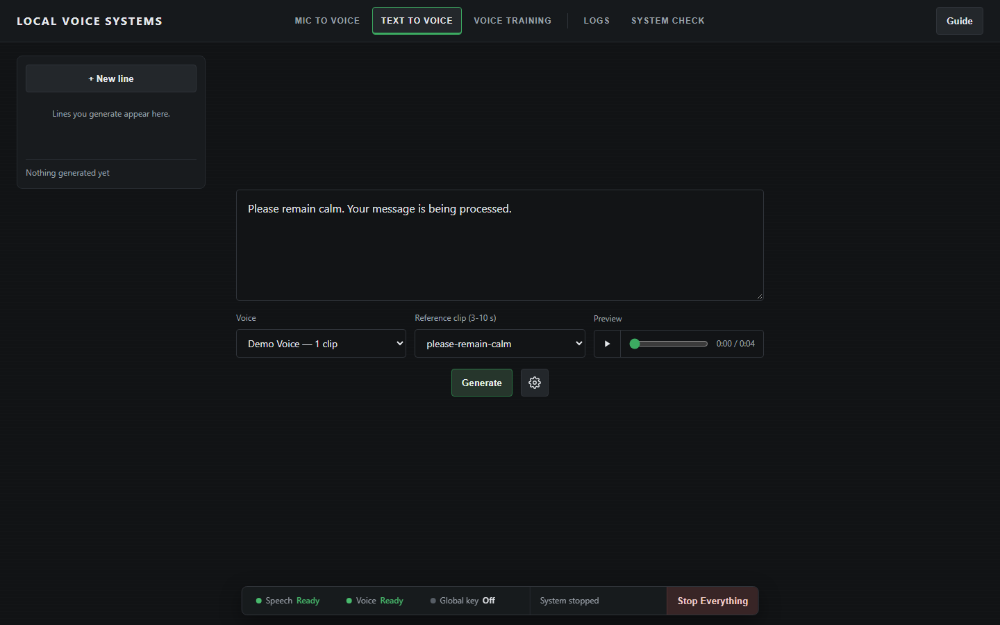

# Local Voice Systems

Speak or type, then hear the words in a reference voice. Runs locally after model downloads.



Requires **Windows 10/11 x64 + WSL2**, Python 3.12, FFmpeg on PATH, and Chrome or Edge.
The dashboard does not support native Linux, macOS, or Windows ARM. CPU mode works but is slow.

## Install

Install [Python 3.12](https://www.python.org/downloads/windows/), [Git](https://git-scm.com/downloads/win), and [FFmpeg](https://ffmpeg.org/download.html) on Windows.
For NVIDIA, install the [Windows driver](https://www.nvidia.com/Download/index.aspx). WSL uses it; do not install a Linux GPU driver.
For AMD, install a recent [AMD Software: Adrenalin Edition](https://www.amd.com/en/support/download/drivers.html) driver.

In administrator PowerShell:

```text
wsl --install -d Ubuntu-24.04
wsl --update
```

Restart if prompted. Open Ubuntu once and create your Linux user.
For NVIDIA, `/usr/lib/wsl/lib/nvidia-smi` inside Ubuntu must list your card ([WSL requirements](https://docs.nvidia.com/cuda/wsl-user-guide/index.html)).

Then, in a normal Windows PowerShell:

```text
git clone https://github.com/alexandru-tanul/local-voice-systems.git
cd local-voice-systems
```

### Engine

Run `Setup-Engine.bat`. It finds your graphics card and asks you to confirm the build, installs GPT-SoVITS in Ubuntu with Miniforge, and writes `config.json`.
It downloads 7 to 15 GB, uses 15 GB of disk space for CPU and about 50 GB for AMD with ROCm, and takes 20 to 60 minutes. If it stops, run it again; it continues where it stopped.

| Graphics card | Build | `tts_device` | `tts_precision` |
| --- | --- | --- | --- |
| RTX 20/30/40/50 | `cu128` | `cuda` | `fp16` |
| GTX 16 | `cu128` | `cuda` | `fp32` |
| GTX 10, Pascal/Volta | `cu126` | `cuda` | `fp32` |
| Radeon RX 7000/9000 | ROCm 7.2 | `cuda` | `fp16` |
| Older NVIDIA, Intel, or no GPU | `cpu` | `cpu` | `fp32` |

<details>
<summary>An existing GPT-SoVITS, or installing by hand</summary>

Setup-Engine.bat leaves a `~/GPT-SoVITS` that it did not install as it is.
To use an existing GPT-SoVITS v2Pro install, copy `config.example.json` to `config.json`, set its three WSL paths to that install, and choose the device and precision from the table.

To install by hand, install [Miniforge for Linux](https://github.com/conda-forge/miniforge#install) inside Ubuntu, reopen Ubuntu, and run the commands below with `build` from the table.
The upstream installer downloads the models and dependencies. Then write `config.json` as above, with full paths: `/home/<user>/GPT-SoVITS`, `/home/<user>/miniforge3/envs/gsv/bin/python`, and a folder for datasets.

```text
sudo apt update
sudo apt install -y build-essential git wget
conda create -y -n gsv python=3.10 uv
conda activate gsv
git clone https://github.com/RVC-Boss/GPT-SoVITS.git ~/GPT-SoVITS
cd ~/GPT-SoVITS
git checkout 48b1a0169a28582a8984402f82cf438d3bfa6aca
build=cu128
uv pip install "torch==2.11.0+$build" "torchaudio==2.11.0+$build" torchcodec==0.11.1 --index-url "https://download.pytorch.org/whl/$build"
printf 'torch==2.11.0\ntorchaudio==2.11.0\ntorchcodec==0.11.1\n' > voice-constraints.txt
CONDA_PINNED_PACKAGES='ffmpeg>=6,<9' PIP_CONSTRAINT="$PWD/voice-constraints.txt" WORKFLOW=true bash install.sh --device "${build^^}" --source HF
```

These pins keep PyTorch, torchaudio, and FFmpeg compatible.
For AMD, `scripts/setup_engine.sh` shows the ROCm steps: AMD's ROCm 7.2 for WSL, and AMD's PyTorch 2.8.0 on Python 3.12.

</details>

### Dashboard

Run `Setup-Relay-Env.bat`, then `Launch-Voice-Dashboard.bat`. Open **System Check** to check the selected device.
Use `Stop-Voice-Dashboard.bat` to stop it. Restart the dashboard after editing `config.json`.

Optional keys, for when a port is taken or you want a different setting:

| Key | Default | Use |
| --- | --- | --- |
| `dashboard_port` | `8790` | Port of the dashboard page |
| `asr_port` | `8792` | Port of speech recognition |
| `tts_port` | `9880` | Port of the voice engine in WSL |
| `asr_model` | `base.en` | [faster-whisper](https://github.com/SYSTRAN/faster-whisper) model of Mic to Voice, for example `small.en` for better accuracy; for other languages it uses the same model without `.en`, or `base` for the English-only `distil` models and for a folder or repository ending in `.en` |
| `dataset_asr_model` | `small.en`, or `small` for other languages | faster-whisper model that writes dataset transcripts |
| `asr_model_dir` | `cache_dir/faster-whisper` | Download folder of the speech and translation models |
| `cache_dir`, `tmp_dir` | `.cache`, `cache_dir/tmp` | Download caches and temporary files |
| `dashboard_python` | `relay_env` | Python that runs the dashboard |
| `restore_python` | `restore_env` | Python that runs Restore audio |
| `api_key` | none | Key that other programs must send to speak with your voices; see [Use in other programs](#use-in-other-programs) |

Speech recognition uses CPU and downloads its model on first use; dataset transcripts use a larger one, about 480 MB.
For noise removal and high frequencies in **Restore audio**, also run `Setup-Restore-Env.bat` once. It downloads about 1 GB, and a model of about 55 MB on first use.
Music and echo removal download GPT-SoVITS's separation models, about 520 MB, on first use.

## Use

The first time, the dashboard offers a short tour that explains each page. **Guide** starts it again.

1. On **Voice Training**, create a dataset and press **+ Add audio**. Speech recognition writes each transcript; check them before adding.
   Recordings over 20 seconds are cut into clips at pauses. The clip list plays, corrects and deletes clips.
   **Check clips** finds clips with a wrong transcript, background noise, distortion, the same audio twice, or a length that training skips, and **Use heard text** puts in what speech recognition hears.
   Press **Sync Only**. The other tabs read clips from the copy in WSL, so sync again after adding clips.
2. On **Text to Voice**, choose the voice and reference clip, enter text, and press **Generate**.
   **Settings** holds the models, such as the pretrained `s1v3.ckpt` / `s2Gv2Pro.pth`, and **Text language**, which follows the dataset's language.
3. On **Mic to Voice**, press **Start**, then hold push-to-talk, speak, and release. Choose audio output in **Settings**.
   **Start** turns on speech recognition, the voice engine, and the global push-to-talk key, and **Stop Everything** stops them.
   **Sync & Prepare** and training stop them first to free GPU memory.
   **Settings** sets the language you speak and the language the voice speaks: English, Chinese, Japanese, Korean or Cantonese, both English at first.
   When they differ, your words are translated by [NLLB-200](https://huggingface.co/facebook/nllb-200-distilled-600M) on the CPU, which downloads about 650 MB on first use. **Its license, CC-BY-NC 4.0, allows only non-commercial use.**
   Chinese and Cantonese need no translation between them: both are written in Chinese characters, which the voice reads in either.
   Speech in languages other than English uses one more speech recognition model, downloaded on first use: about 145 MB with the standard `asr_model`. A voice sounds best in the language of its own clips.

Datasets can be English, Chinese, Japanese, Korean, or Cantonese.
To train a voice, add more clips, press **Sync & Prepare**, then train SoVITS and GPT with batch size 1. Each shows its progress by epoch.
SoVITS can be v2Pro or v2ProPlus, GPT-SoVITS's larger model, which sounds better and needs more GPU memory. Both use the same preparation and GPT model.
**Compare epochs** then says one test line with each saved epoch; **Use this** gives the best one to Text to Voice and Mic to Voice.
To import a folder of clips at once, with transcripts from a CSV with the columns `file,text`:

```text
python import_dataset.py --name "My Voice" --audio-dir C:\clips --transcripts C:\clips\lines.csv
```

Without `--transcripts`, each transcript comes from the file name. Add `--language` for a dataset that is not English.

### Restore audio

**Restore audio**, a tab on **Voice Training**, cleans up recordings before training. In this order, it can remove music and sound effects, echo and reverb, and background noise, and restore missing high frequencies.
Music and echo removal use GPT-SoVITS's UVR5 models in WSL, on the GPU unless `tts_device` is `cpu`; the rest uses [LavaSR](https://github.com/ysharma3501/LavaSR) on the CPU.
Each result is added to the list, so steps can be combined, compared, and added to a dataset, where long recordings are cut into clips.

### Share a voice

**Export voice**, in the Text to Voice **Settings**, saves both models and the reference clips as one file. **Import a voice** installs such a file as a new voice.

### Use in other programs

While the dashboard runs, programs that work with OpenAI's speech service can speak with your voices at `http://127.0.0.1:8790/v1`.
A voice is offered there once it has spoken a line on Text to Voice, and it speaks with that line's models, reference clip and settings. An imported voice is offered at once.

- Open WebUI: in its audio settings, choose the OpenAI text-to-speech engine, enter `http://127.0.0.1:8790/v1` as the API base URL and any key, and pick a voice from its list.
- SillyTavern: choose the OpenAI Compatible TTS provider, enter `http://127.0.0.1:8790/v1/audio/speech` as the provider endpoint, and list voice ids, such as `my-voice`, as the available voices.
- Other programs: `POST /v1/audio/speech` with `input` and `voice`, and optionally `response_format` (`mp3`, the default, `opus`, `aac`, `flac`, `wav` or `pcm`) and `speed`. `GET /v1/audio/voices` lists the voice ids.

With `api_key` in `config.json`, a program must send it as `Authorization: Bearer <key>` to speak; the voice list stays open, as Open WebUI asks for it without the key.

Generated audio is saved in `outputs`. Mic to Voice keeps only its newest 200 lines, in `outputs\relay`.
Use [VB-CABLE](https://vb-audio.com/Cable/) to send the generated voice to another app.

## Fix

- GPU error: check the Windows driver and build. To use CPU, set `tts_device` to `cpu`.
- Setup-Engine.bat says WSL cannot look up names on the internet: give Ubuntu a working DNS server in `/etc/resolv.conf`, then run it again.
- Noise or NaNs: use `tts_precision: "fp32"`. Out of memory: stop other GPU jobs, reduce batch size, or use CPU.
- Upload fails: run `ffmpeg -version` in Windows. Missing WSL files: check the paths in `config.json`.
- Restore audio says noise removal needs `Setup-Restore-Env.bat`: run it.
- A dataset transcript says speech recognition is from an older version: press **Stop Everything**, then try again.

## Check

```text
python -m unittest discover -s tests
```

CI checks Windows and Linux. Training and generation were tested on Windows 10 with an AMD Radeon RX 7900 XTX, through ROCm in WSL2, and CPU synthesis in Ubuntu. NVIDIA GPUs remain untested.
`Setup-Engine.bat` was tested with the CPU and AMD builds, each in a fresh Ubuntu 24.04.

[GPT-SoVITS](https://github.com/RVC-Boss/GPT-SoVITS) with the [UVR5](https://github.com/Anjok07/ultimatevocalremovergui) separation models · [faster-whisper](https://github.com/SYSTRAN/faster-whisper) · [NLLB-200](https://huggingface.co/facebook/nllb-200-distilled-600M) (CC-BY-NC 4.0, non-commercial), downloaded for translation · [LavaSR](https://github.com/ysharma3501/LavaSR) (Apache-2.0) with the [UL-UNAS](https://github.com/Xiaobin-Rong/ul-unas) noise remover (MIT), downloaded by `Setup-Restore-Env.bat` · [MIT](LICENSE)
