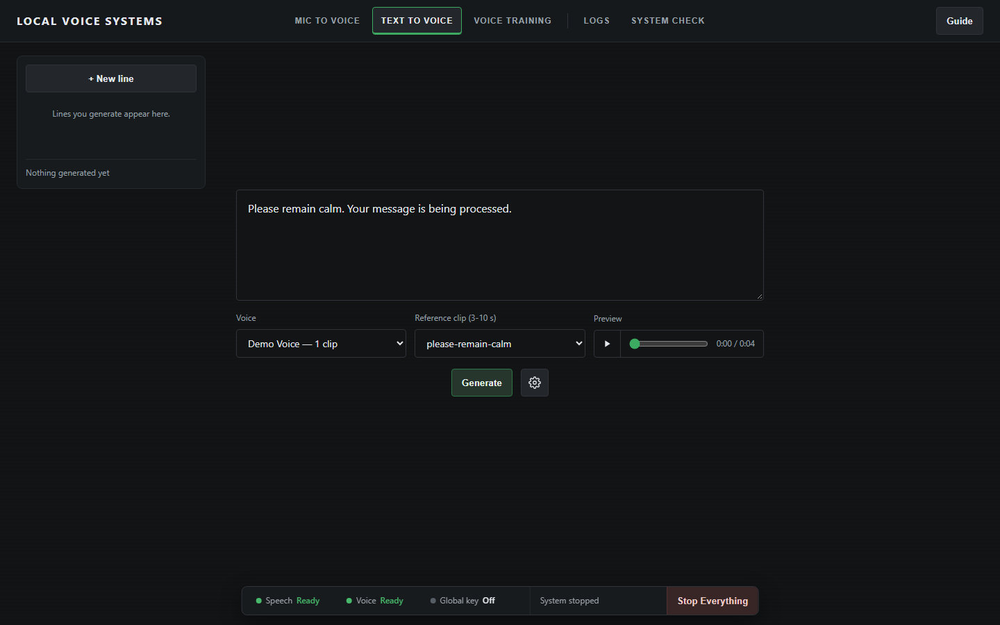

# Local Voice Systems

Speak or type, then hear the words in a reference voice. Runs locally after model downloads.



Requires **Windows 10/11 x64 + WSL2**, Python 3.12, Git, FFmpeg on PATH, and Chrome or Edge.
Native Linux, macOS, and Windows ARM are not supported. CPU mode works but is slow.

## Install

1. On Windows, install [Python 3.12](https://www.python.org/downloads/windows/), [Git](https://git-scm.com/downloads/win), [FFmpeg](https://ffmpeg.org/download.html), and your GPU driver ([NVIDIA](https://www.nvidia.com/Download/index.aspx) or [AMD Adrenalin](https://www.amd.com/en/support/download/drivers.html)). Do not install a Linux GPU driver in WSL.
2. In administrator PowerShell, run `wsl --install -d Ubuntu-24.04` and `wsl --update`. Restart if prompted, then open Ubuntu once to create your Linux user.
3. Clone the repository:
   ```text
   git clone https://github.com/alexandru-tanul/local-voice-systems.git
   cd local-voice-systems
   ```
4. Run `Setup-Engine.bat`. It detects your GPU, installs GPT-SoVITS in Ubuntu, and writes `config.json`. It downloads 7 to 15 GB, needs 15 to 50 GB of disk space, and takes 20 to 60 minutes. If it stops, run it again; it resumes.
5. Run `Setup-Relay-Env.bat`, then `Launch-Voice-Dashboard.bat`, and open **System Check**. `Stop-Voice-Dashboard.bat` stops it.

| Graphics card | Build | `tts_device` | `tts_precision` |
| --- | --- | --- | --- |
| RTX 20/30/40/50 | `cu128` | `cuda` | `fp16` |
| GTX 16 | `cu128` | `cuda` | `fp32` |
| GTX 10, Pascal/Volta | `cu126` | `cuda` | `fp32` |
| Radeon RX 7000/9000 | ROCm 7.2 | `cuda` | `fp16` |
| Older NVIDIA, Intel, or no GPU | `cpu` | `cpu` | `fp32` |

To use an existing GPT-SoVITS v2Pro install or to install by hand, see [docs/INSTALL.md](docs/INSTALL.md).
Optional settings such as ports, speech recognition models, and `api_key` are in [docs/CONFIG.md](docs/CONFIG.md). Restart the dashboard after editing `config.json`.

## Use

The dashboard offers a short tour the first time; **Guide** starts it again. Details are in [docs/USAGE.md](docs/USAGE.md).

1. **Voice Training**: create a dataset and press **+ Add audio**. Transcripts are written for you and long recordings are cut into clips. Run **Check clips**, then **Sync Only**.
2. **Text to Voice**: choose a voice and reference clip, enter text, and press **Generate**.
3. **Mic to Voice**: press **Start**, hold push-to-talk, and speak. It can translate between English, Chinese, Japanese, Korean, and Cantonese with [NLLB-200](https://huggingface.co/facebook/nllb-200-distilled-600M). **Its license, CC-BY-NC 4.0, allows only non-commercial use.**

To train a voice, press **Sync & Prepare**, train SoVITS (v2Pro or v2ProPlus) and GPT, then pick the best epoch with **Compare epochs** and **Use this**.

Also: **Restore audio** removes music, echo, and noise before training (run `Setup-Restore-Env.bat` once for noise removal); **Export voice** / **Import a voice** share a voice as one file; `import_dataset.py` imports a folder of clips.

### Use in other programs

While the dashboard runs, it serves an OpenAI-compatible speech API at `http://127.0.0.1:8790/v1` for Open WebUI, SillyTavern, and similar programs: `POST /v1/audio/speech` with `input` and `voice`, and `GET /v1/audio/voices`. Set `api_key` in `config.json` to require a key. Setup for each program is in [docs/USAGE.md](docs/USAGE.md#use-in-other-programs).

## Fix

- GPU error: check the Windows driver and build, or set `tts_device` to `cpu`.
- Noise or NaNs: set `tts_precision` to `fp32`. Out of memory: stop other GPU jobs, reduce batch size, or use CPU.
- Upload fails: run `ffmpeg -version` in Windows. Missing WSL files: check the paths in `config.json`.
- Setup-Engine.bat says WSL cannot look up names: give Ubuntu a working DNS server in `/etc/resolv.conf` and run it again.
- Restore audio asks for `Setup-Restore-Env.bat`: run it.
- A transcript says speech recognition is from an older version: press **Stop Everything** and try again.

## Check

```text
python -m unittest discover -s tests
```

CI checks Windows and Linux. Tested on an AMD Radeon RX 7900 XTX (ROCm in WSL2) and on CPU; NVIDIA GPUs remain untested.

[GPT-SoVITS](https://github.com/RVC-Boss/GPT-SoVITS) with [UVR5](https://github.com/Anjok07/ultimatevocalremovergui) · [faster-whisper](https://github.com/SYSTRAN/faster-whisper) · [NLLB-200](https://huggingface.co/facebook/nllb-200-distilled-600M) (CC-BY-NC 4.0, non-commercial) · [LavaSR](https://github.com/ysharma3501/LavaSR) (Apache-2.0) with [UL-UNAS](https://github.com/Xiaobin-Rong/ul-unas) (MIT) · [MIT](LICENSE)
